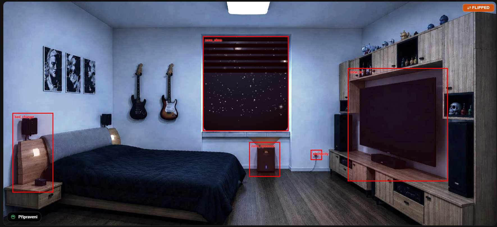
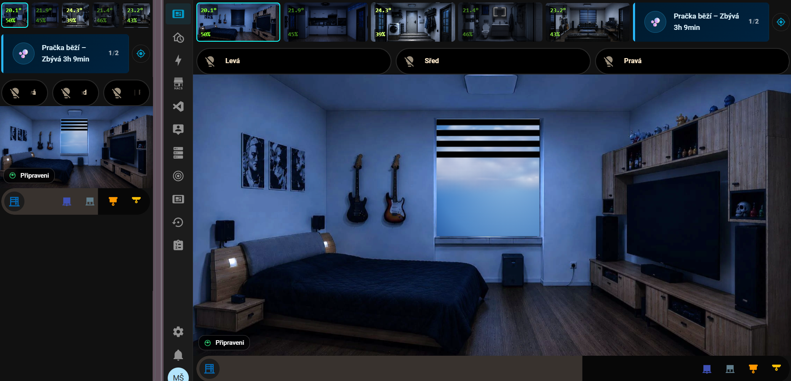
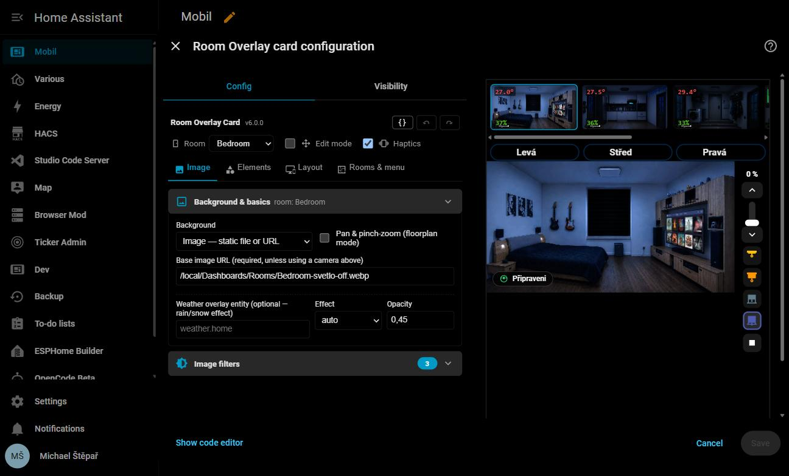
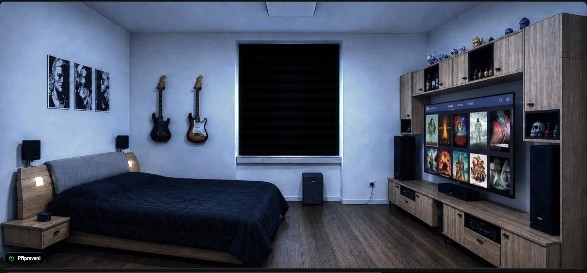
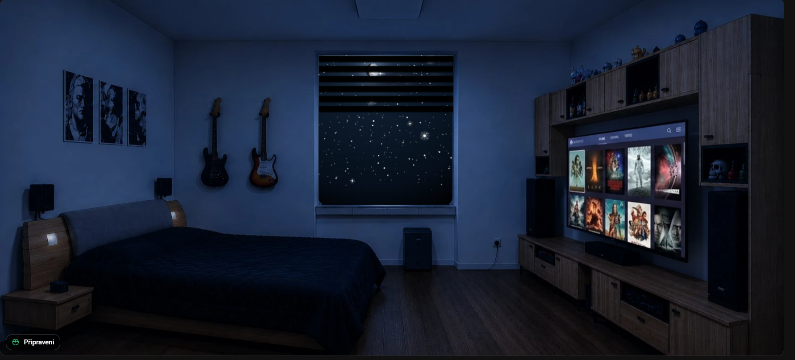
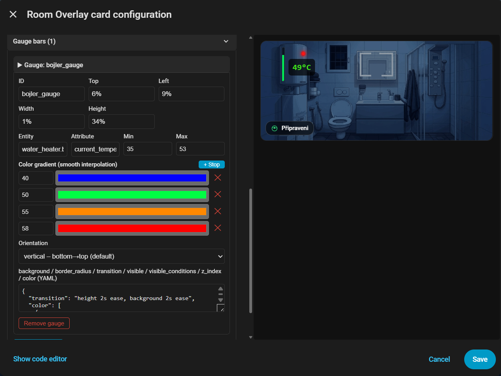
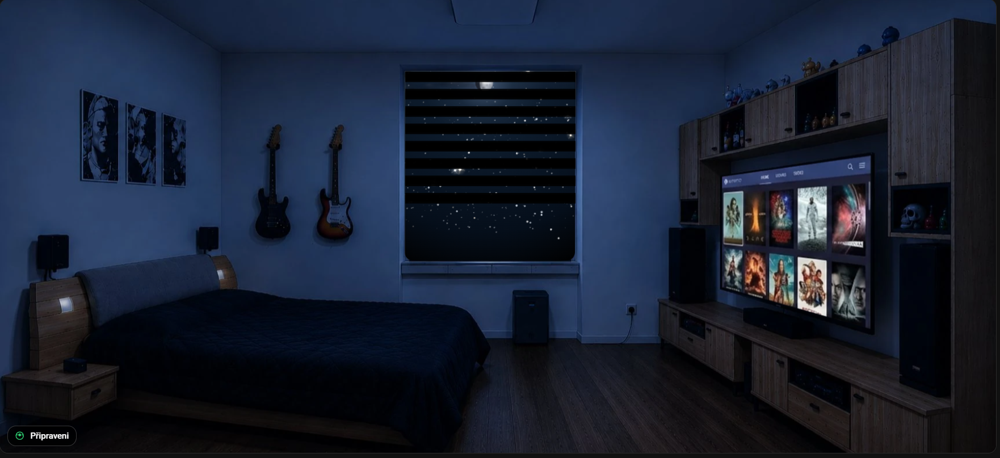
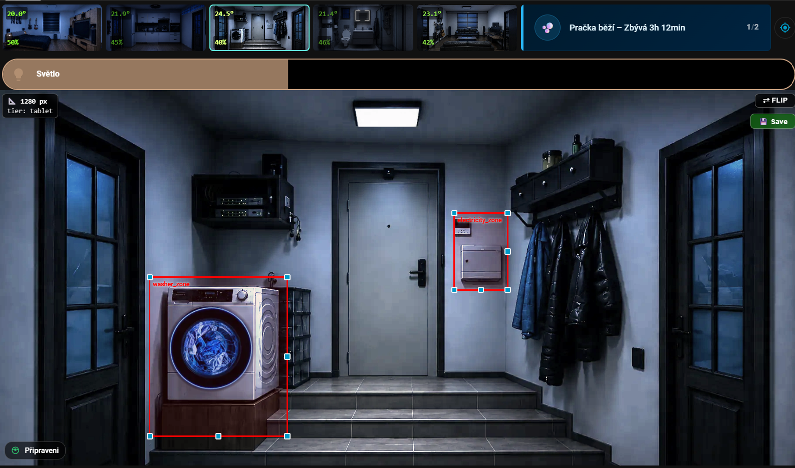

# Room Overlay Card

[](https://github.com/hacs/integration)
[](https://github.com/Michailjovic/Room-Card/releases/latest)
[](LICENSE)

A Home Assistant Lovelace card for **room visualization**. Take a photo of your room and bring it to life: dim it with the lights, place clickable controls on the furniture, show live sensor values, animate the blinds, and embed any other HA card on top of it.

**One card adapts to every screen** — you design two layout profiles (portrait / landscape) on a % grid of the viewport and every device picks the right one by its shape. Everything is configurable from a full tabbed GUI editor; you can build a whole card by dragging elements onto the image, no YAML required.



---

## Features at a glance

| Feature | What it does |
|---|---|
| **Layout profiles** | Two GUI-built % grid layouts (portrait / landscape) picked by the viewport's shape; per-device pinning via browser_mod |
| **Base image** | Any room photo, per-profile design aspect, cover/contain fit, configurable corner radius |
| **CSS filter engine** | Brightness, saturation, sepia, blur… driven by entity states with smooth transitions |
| **Brightness model** | Multi-stop filter interpolation: define stops (day / night / cinema…) and blend automatically |
| **Overlay layers** | Transparent PNG layers with conditional opacity/filter; state-driven image switching |
| **Transform engine** | Any overlay can move with its entity — a door swinging on its hinge, a garage door sliding up, a fan whose spin speed follows its percentage |
| **Gauges** | Animated progress bars in 6 fill directions, color gradients, per-gauge visibility |
| **Blinds** | Roller, venetian slat, and day/night (zebra) blind animations driven by cover entities, plus an icon-only cover controller |
| **Clickable zones** | Invisible hit areas — navigate, more-info, toggle, call-service, browser-mod popup |
| **Slider zones** | Drag across a zone to dim lights, move covers, set volume/temperature |
| **Status badges** | Floating chips in any corner — MDI icon, conditional color, conditional label |
| **Vacuum status widget** | Compact cross-room/global badge summarising multiple vacuums (dry/wet/both/error) — informational only, taps through to your own dashboard |
| **Icons & labels** | State-aware MDI icons and entity/template text values placed anywhere |
| **Embedded HA cards** | Any card (tile, mini-graph, button…) placed at absolute coordinates |
| **Companion cards** | Full HA cards stacked above / below the image (great for mobile) |
| **Light controls** | A slider strip per light/switch, border colour tracking a lux sensor |
| **Cockpit sections** | Pop-up panels of status/control tiles (device photos with moving parts, quick buttons) opened from launcher icons that show what's running inside |
| **Light glow** | Soft pools of light blended onto the photo — colour from the light, strength from its brightness; circle / ellipse / directional wash, optional flicker |
| **Camera & weather** | Live camera snapshot as the base layer; animated rain/snow overlay |
| **Multi-room** | One card for the whole home — define rooms, swipe & presence-follow |
| **Overview page** | Every room on one screen as a live tile with state chips, plus your header (ticker, pills), weather/calendar cards and a dock of section launchers; tap a tile and the room zooms open. Photo tiles or list rows on phones |
| **Auto navigation menu** | The room switcher (thumbnails / tabs / dots) is generated automatically from your rooms — you never build the menu by hand |
| **Hold feedback** | A progress ring fills and turns green when a hold gesture registers |
| **Tabbed GUI editor** | Build everything visually — drag, resize, reorder — without writing YAML |

---

## Screenshots

| | |
|---|---|
|  |  |
| *One card, every screen — the same card at different widths* | *Tabbed GUI editor (v6.0.0) — build it without YAML, [full walkthrough with more screenshots](docs/EDITOR.md)* |
|  |  |
| *Day scene — full brightness* | *Night mode — dim filter active* |
|  |  |
| *Gauges — temperature, humidity, CO₂* | *Day/night zebra blind at 60 %* |
|  | |
| *Test mode — click to select, drag to position* | |

---

## Installation

### Via HACS (recommended)

Room Overlay Card is in the default HACS store — no custom repository needed.

1. Open **HACS → Frontend** and search for **Room Overlay Card**
2. Click **Download**
3. Hard-refresh your browser (`Ctrl+Shift+R`)

To install a specific version (for example to roll back), open the card in HACS → **⋮ → Redownload** and pick the version.

> **Upgrading from the custom-repository install?** Nothing breaks — the resource URL stays the same. You can remove `Michailjovic/Room-Card` from **HACS → ⋮ → Custom repositories**; the card stays installed and keeps updating from the default store.

### Manual

1. Download `room-overlay-card.js` **and** `room-overlay-card-studio.js` from the [latest release](https://github.com/Michailjovic/Room-Card/releases/latest)
2. Copy both to `/config/www/` (same folder; the studio file is loaded only when someone opens the studio)
3. **Settings → Dashboards → ⋮ → Manage resources** → add `/local/room-overlay-card.js` (type: JavaScript module) — the studio file needs no resource of its own
4. Hard-refresh

---

## Quick start (no YAML)

1. **Add the card** to a dashboard — *Add card → Custom: Room Overlay Card*.
2. The editor opens on a single step: **set a background image** (a room photo or floor-plan, e.g. `/local/bedroom.webp`). The rest of the editor appears once it's set.
3. Press **Studio** in the editor header: the card opens full-screen on a live canvas, with the
   editor next to it.
4. **Add** an icon, label, zone, gauge, light glow, blind or embedded card and click (or drag a
   box) on the image where it belongs. Click any element to select it: it opens in the editor
   panel on the right, and you can drag it, resize it, duplicate, copy it to another room or
   delete it.
5. **Apply & close**, then Save in Home Assistant. That's it — you never had to touch YAML.

On the dashboard itself, Home Assistant's edit mode (the pencil) puts a **✎ Studio** button on the
card, which saves straight to the dashboard — handy on a wall tablet. More in the
[editor guide](docs/EDITOR.md#room-card-studio).

The smallest possible card in YAML:

```yaml
type: custom:room-overlay-card
base_image: /local/images/bedroom.webp
aspect_ratio: "16/9"
```

---

## The overview page (v6.30.0)

Add one more "room" that is an **overview**: every room on one screen as a tile — its live
picture, temperature, and round chips for its lights, blinds and media — with an optional header
(your alert ticker, status pills), a column of cards (clock, weather, calendar) and a dock of
section launchers. Tap a tile and the room zooms open in its usual view. Any region you leave out
gives its space to the room grid; on a phone, only the grid scrolls and you pick photo tiles or
list rows.

```yaml
rooms:
  - id: overview
    name: Overview
    overview:
      header: { items: [ { nav_cards: true } ] }   # your ticker, from nav.cards
      left: { cards: [ { type: weather-forecast, entity: weather.home } ] }
      grid: { columns: { landscape: 3, portrait: 2 } }
      dock: {}                                      # one launcher per section
  - id: bedroom
    …
```

In the editor: **Rooms & menu → + Overview**. Full reference:
[Configuration → Overview page](docs/CONFIGURATION.md#overview-page-v6300).

---

## Documentation

This README is a landing page — the full reference lives here:

| Doc | What's in it |
|---|---|
| **[docs/CONFIGURATION.md](docs/CONFIGURATION.md)** | Every YAML key: layout grids, filters, overlays, gauges, blinds & cover control, zones, badges, icons/labels, embedded cards, light controls, multi-room, the overview page, a complete example |
| **[docs/EDITOR.md](docs/EDITOR.md)** | The full-screen Room Card Studio, the GUI editor tab by tab, the legacy Edit mode, and a summary of the editor UX rebuild that shipped in v5.9.0–v5.10.1 |
| **[LAYOUT.md](LAYOUT.md)** | Layout-engine implementation spec, for the curious or the contributing |
| **[PRESETS.md](PRESETS.md)** | Copy-paste recipes — day/night filters, weather moods, dimmer zones, door portals, presence multiroom, a whole-home overview page |

---

## Development

The source lives in `src/` as plain-JavaScript parts (no framework, no transpiling) that
`npm run assemble` concatenates, in the order listed in `src/manifest.json`, into
`room-overlay-card.js` and the lazy-loaded `room-overlay-card-studio.js`. The assembled files stay committed — they are what a manual/local install
loads and what every test tier runs against — and CI fails when it is out of date with `src/`.
`npm run build` then produces the minified release asset (terser, property mangling off) that
HACS installs.

```
src/core/     shared helpers: layout, glow, transform, migration, rooms, sections, overview, formatting…
src/card/     the card element (room-overlay-card)
src/editor/   the GUI editor element (room-overlay-card-editor), its YAML helpers, the studio loader
src/studio/   Room Card Studio → room-overlay-card-studio.js (second bundle, loaded on demand)
src/schema/   the config schema registry — every key, its type and scope (bundled into the studio)
tools/        assemble.js
```

```bash
npm run assemble        # src/ → room-overlay-card.js + room-overlay-card-studio.js (run after every edit in src/)
npm test                # assemble check + smoke, render, lifecycle, design, overview, schema, studio tiers (jsdom)
npm run test:e2e        # Playwright: geometry regression + studio tests, real Chromium
npm run test:compat     # render every reference config with the last release and this build, compare
npm run test:ha         # real Home Assistant in Docker: editor dialog, studio, dashboard save paths
npm run build           # build the minified dist/ bundles
npm run build:verify    # build, then run the test tiers against the minified bundle
```

---

## License

MIT © 2025–2026 Michailjovic

The card embeds [js-yaml](https://github.com/nodeca/js-yaml) 4.3.2 (MIT, © Vitaly Puzrin) for the
editor's YAML fields; its license text is reproduced in `room-overlay-card.js`.
