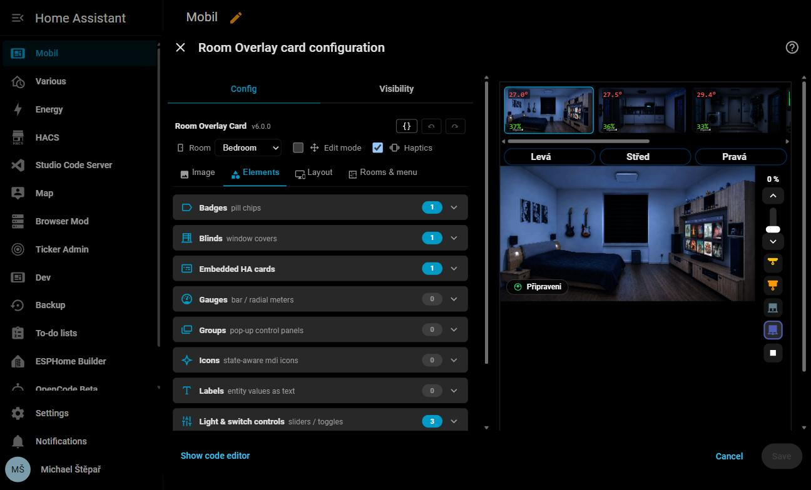
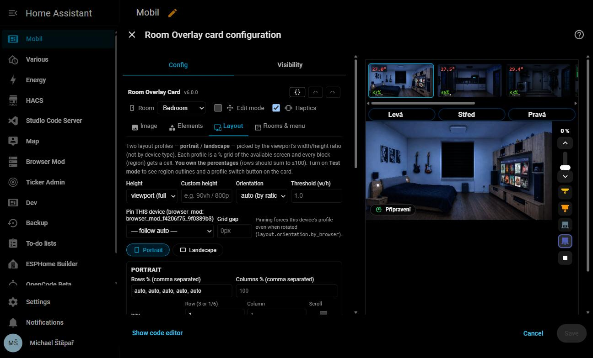
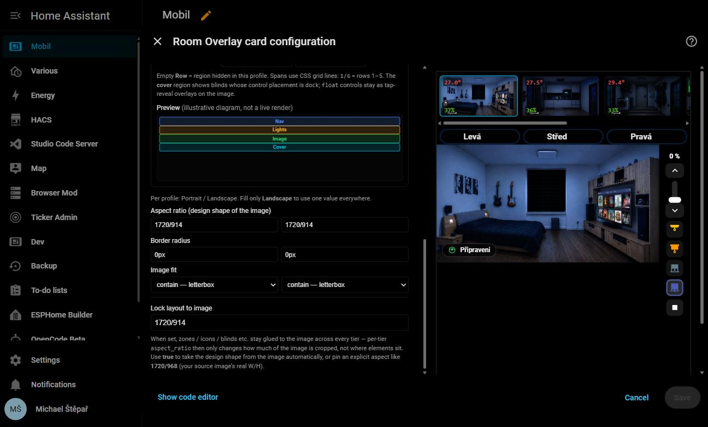
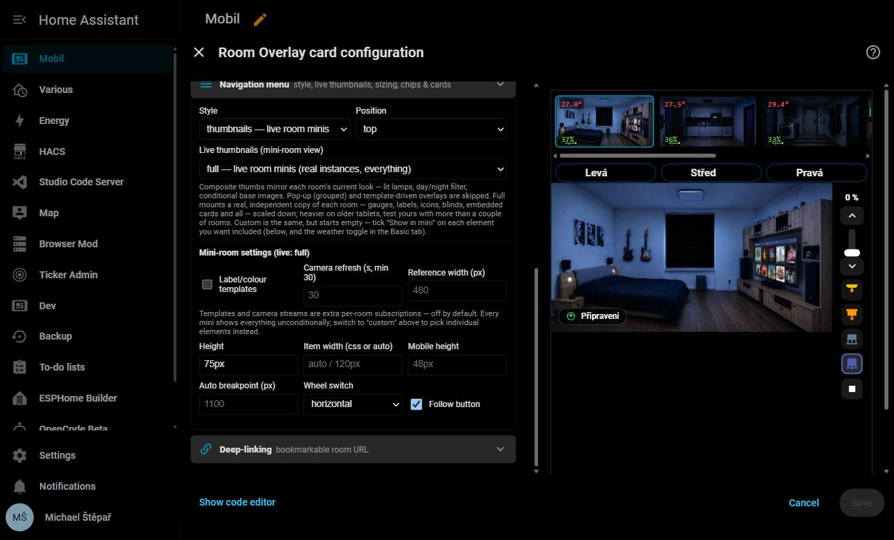

# Editor guide

[← Back to README](../README.md) · See also: [Configuration reference](CONFIGURATION.md) · [Preset gallery](../PRESETS.md)

The whole card can be built without writing YAML: add it, set a background, and everything else
happens by dragging on the image and filling in tabbed panels. This page walks through the
editor as it exists today, then summarizes the UX rebuild that got it here.

---

## Getting started

1. **Add the card** to a dashboard — *Add card → Custom: Room Overlay Card*.
2. The editor opens on a single step: **set a background image** (a room photo or floor-plan,
   e.g. `/local/bedroom.webp`) or a live camera. The rest of the editor appears once one is set —
   a narrow, unambiguous first step with no premature choices.
3. Press **Studio** in the header. The card opens full-screen on a live canvas with this editor
   beside it ([Room Card Studio](#room-card-studio)).
4. **Add** an icon, label, zone, gauge, light glow, blind or embedded card and click (or drag a
   box) where it belongs on the image. Click any element to select it: its panel opens on the
   right.
5. **Apply & close**, then Save. You never had to touch YAML.


*The editor opens on the **Image** tab. `v6.0.0` next to the card name (top left) is the
installed version — check it here if something in this guide doesn't match what you see. The
panel on the right is a live, draggable preview of the room you're editing, not a static
mock-up.*

---

## Header (always visible)

- **Room picker** — when the card is multi-room, switches which room the *Image* and *Elements*
  tabs edit.
- **Studio** — opens this editor full-screen next to a large live canvas, see
  [Room Card Studio](#room-card-studio).
- **Haptics** — feedback on actions (companion app) and hold-gesture registration.
- **Edit mode (legacy)** — only on a card that still has `test_mode: true`, so it can be switched
  off; see [below](#edit-mode-legacy).

## The five tabs

- **Image** — the background (image or camera), image-swap conditions, weather overlay, CSS
  filters, the brightness model, filter transition and zoom. Also the **companion cards** (above
  / below the image) and **light controls**.
- **Elements** — everything you place on the image: zones, icons, labels, badges, gauges,
  blinds, embedded cards, overlays, light glows, and groups. Each type is a collapsible section with a count,
  listed alphabetically (icons next to each label make it scannable without needing to reorder
  by intent).

  

  *A room with one badge, one blind, one embedded card, and three light controls — the badge
  next to each count (blue "1"/"3") is the quick way to see what a room actually uses without
  opening every section.*

  Any zone, icon, element or blind (not badges) also carries a **Section** field at the bottom of
  its own panel — pick a section declared on the **Sections** tab to add that item's tile to the
  matching cockpit panel, with a `tile:` YAML box (name/entity/icon/state/etc.) that only appears
  once a section is picked, plus its own **Image** field and an **Aspect ratio** field (v6.11.2 —
  overrides the tile stage's default 4:3 box, e.g. `16/9` for a widescreen TV/monitor photo). Fill
  in the image and the tile switches from an icon to a device photo, revealing an **Overlays**
  list — add / remove / reorder overlays
  each with the exact same panel a room's own overlays get (Image URL, Conditions YAML, and a
  **Transform** sub-panel with the states/range/spin mode select), just scoped to that one tile.
  See [Configuration → Sections & panels](CONFIGURATION.md#sections--panels-cockpit-tiles).

- **Sections** — declares cockpit panels (`sections:`): id, title, icon, placement
  (sheet-right / sheet-bottom / full / dialog), size, columns, subtitle, badge mode, the
  tap-outside-to-close backdrop, an optional `visible_template`, and the content source —
  *Collected only* (tiles from whatever's tagged with this section elsewhere in the card, shown
  here as a live read-only list so you can see at a glance what's tagged in), *Auto* (a Domain
  select — climate / cover / media player / vacuum / fan / light / switch — adds one tile per
  matching entity not already tagged in), or *Embedded card* (a YAML box for a single `card:`
  block). Collected tagging always applies regardless of which of these is picked, so a section
  can combine all three. Add / duplicate / remove / reorder sections the same way as any other
  Elements list.

  Each section also has its own **Declared tiles** list (v6.11.3) — content the section owns
  outright, no room/zone/icon tag needed at all (a TV summary, a projector remote). *+ Tile* adds
  one; each gets an ID field (optional — falls back to `<section id>_tile_<index>`), the same
  structured tile fields and [action builder](#actions-tap--double-tap--hold) as a tagged tile, a
  small YAML box for whatever has no field of its own (`hold_delay`, …), and the exact same
  **Image** field / **Aspect ratio** override / **Overlays** editor a tagged element's tile gets —
  plus ▲▼ reorder, Duplicate and Remove. See
  [Configuration → Declared tiles](CONFIGURATION.md#declared-tiles-tiles).

  Next to *+ Add section*, a **Recipe** select pre-fills a whole section for a common case
  (Appliances, Cleaning, Media, Heating, Covers, Electricity, Weather; Electricity needs
  `electricity-panel-card` installed and is disabled otherwise) — pick one instead of
  filling in id/title/icon/source by hand. Below the section list, a **Find untagged devices**
  box lists vacuum/climate/cover/media_player entities Home Assistant knows about that aren't in
  any section yet, grouped by domain, each with a one-click button that adds the matching recipe.
  See [Configuration → Onboarding](CONFIGURATION.md#onboarding-editor-only).

- **Layout** — height source, orientation, threshold, and both profile grids as Portrait /
  Landscape sub-tabs, each with a live mini grid preview. See
  [Configuration → Layout](CONFIGURATION.md#layout--two-profiles-on-a--grid) for the underlying
  YAML.

  
  

  *Rows/columns as comma-separated percentages on the left; the coloured preview underneath
  (Nav / Lights / Image / Cover) redraws live as you type, so a typo that breaks the grid shows
  up immediately instead of on save.*

- **Rooms & menu** — four accordions: Room identity, Presence & follow, Navigation menu, and
  Deep-linking. *Navigation menu* has **Thumbnail rows — portrait / landscape** and **Strip
  cards** (beside / below) for a multi-row thumbnail grid (v6.25.0, see
  [Configuration → Thumbnail rows](CONFIGURATION.md#thumbnail-rows-and-the-strip-cards-v6250)); nav keys
  the form has no field for (`dim_inactive`, …) are kept on save. Add / remove / reorder rooms here. While the card is still single-room and the
  connected Home Assistant exposes its area registry, a **Create a room for each area** button
  offers to bootstrap the whole `rooms:` list from `hass.areas` in one click, with each area's
  entities pre-assigned as icons — see
  [Configuration → Onboarding](CONFIGURATION.md#onboarding-editor-only).
- **+ Overview** (next to *+ Room*, v6.30.0) adds an **overview page** — a room that shows every
  other room as a tile. Pick it in the header's room select and *Rooms & menu* shows an
  **Overview page** accordion instead of the photo tools (the Image tab says so):
  - transition (zoom / fade / none) and its duration, an optional background image, and *Hide
    this page from the other rooms' thumbnail strip*;
  - **Header** — on/off, height, and a list of items: *Pill* (entity, icon, attribute, prefix,
    suffix, decimals or a template, tap / hold via the action builder), *Nav strip cards* (the
    same cards as *Navigation menu → Cards*, e.g. your alert ticker) or *Card (YAML)*; each with a
    width and *both / landscape only / portrait only*; ▲▼ and Remove;
  - **Left column / Right column** — on/off, width, where it goes on phones (above / below the
    grid / hidden) and its cards as a YAML list (`media: portrait|landscape` per card);
  - **Room grid** — all rooms, or an ordered list (v6.31.0: tick the rooms to show and order
    them with ▲▼ — the grid's own order, the nav strip keeps `rooms:` order), columns and tile
    style (photo tiles / list rows) per profile, tile picture (same as the nav thumbnails, live,
    composite, photo only), live tile reference width, state chips per profile, *Show room names
    on the tiles*, the rooms' info chips, gap;
  - **Dock** — on/off, all sections or a checklist, icon size.

  Every other room then gets an **Overview tile** accordion: tile name, *Name on the tile* (as
  the overview page sets it / always show / hide, v6.31.0), *Leave this room out*,
  **focus** (two sliders with a live crop preview of the photo) and **state chips** — automatic
  (it lists what it derived: the room's lights, cover-controlled blinds and media players), your
  own list (entity, icon, *active when state is*, tap / hold builder, ▲▼, Remove; switching from
  automatic starts the list with what automatic showed) or none. A region you switch off
  collapses on the card and the grid takes its space. See
  [Configuration → Overview page](CONFIGURATION.md#overview-page-v6300).

### Actions (tap / double tap / hold)

Since v6.18.0 every zone, icon and cockpit tile — and the room's own *Tap on the image* — sets its
actions with a small builder instead of a YAML box: one row per gesture (**Tap**, **Double tap**,
**Hold**), a type select, and only the fields that type needs.

| Type | Fields |
|---|---|
| More info / Toggle | Entity (a tile pre-fills its own entity) |
| Navigate | Path (`/lovelace/…`) |
| Open URL | URL |
| Perform action | Action (`domain.service`), target entity (comma-separated for several), optional data (YAML) |
| Open section / Close section | Section (select from the Sections tab) |
| Switch room / Next / Previous / Follow room | Room (select) |
| Toggle / Show / Hide group | Group (select from the room's groups) |
| Do nothing (none) | — |
| Custom (YAML) | the whole action as YAML — anything the builder doesn't model |

- **Nothing is lost.** Actions the builder doesn't model (`fire-dom-event`, `browser-mod-popup`, a
  conditional `{condition, then, else}`, …) open as *Custom (YAML)*. Extra keys such as
  `confirmation:` or `data:` are kept when you edit a field, and a row you didn't touch is saved
  exactly as it was — an old `call-service` action is only rewritten to `perform-action` once you
  edit it.
- **— not set —** removes the key.
- Changing the type swaps the fields in place (no re-render, focus stays put).
- Labels, gauges, badges and vacuum widgets still take their actions in their combined YAML box.

### Entity fields and ID checks

Since v6.19.0:

- **Suggestions with names.** Typing in an entity field suggests matching entities with their
  friendly names (type part of the name or the id). Fields that only make sense for one domain
  suggest only that domain: blind → `cover`, light controls and light glows → `light`/`switch`,
  base camera → `camera`, weather overlay → `weather`, lux sensor → `sensor`, tile progress →
  `sensor`/`number`/`input_number`. You can still type anything.
- **Entity hint.** Under the field: the entity's friendly name, or an orange *Not found in Home
  Assistant* for an unknown id. Templates (`{{ … }}`) are not checked.
- **ID check.** An element ID that is empty, uses characters outside `A-Za-z0-9_-`, or repeats an
  ID in the same list gets a red border and a short message as you type. Since v6.21.0 the message
  carries a one-click fix (*Use "roleta_bedroom"*) — except for section and group IDs, which other
  settings refer to by name.
- **Phones / narrow dialogs.** Field rows fold to two columns below 500 px of editor width and to
  one below 300 px.

### Live navigation thumbnails (`nav.live`)

One of the more popular settings, and easy to miss: on the **Navigation menu** accordion, the
**Live thumbnails** dropdown controls whether the room-switcher thumbnails at the top of the card
are static images or living miniatures of each room.



- **off** — plain thumbnail images.
- **composite** — thumbnails layer in each room's currently-active overlays (lit lamps, open
  windows…) and its filters, so a dimmed room looks dimmed in the menu too. Cheap — pure CSS
  compositing, no extra card instances.
- **full** — every thumbnail is a real, independent mini `room-overlay-card` — gauges, labels,
  icons, badges, blinds, all of it, scaled down. Heaviest option; the *Mini-room settings* panel
  shown above lets you cap the cost (`Reference width`, `Camera refresh`, and whether
  label/colour templates subscribe at all). If one specific element is still too cramped or
  cluttered at thumbnail scale (v6.15.0), its own panel has a "Hide from mini" checkbox — check it
  to keep just that element out of the room's own thumbnail without giving up `full` for anything
  else.
- **custom** — same real-instance mechanism as `full`, but starts empty; you opt individual
  elements in with a "Show in mini" checkbox on their own panel. Use this when a room is too busy
  to look good shrunk down whole.

The underlying YAML (`nav.live`, `nav.mini.*`) is documented in
[Configuration → Multi-room](CONFIGURATION.md#multi-room-one-card--whole-home).

## Room Card Studio

The studio (v6.41.0, canvas editing since v6.42.0, its own forms since v6.44.0) is where cards
are built. It takes the whole screen, above Home Assistant's own dialog, and shows the real card
large on a canvas next to a form for whatever is selected — with this editor one tab away. It is
the v7 editor in the making ([`V7_PLAN.md`](../V7_PLAN.md) §5).

**Opening it**

- the **Studio** button in the editor header;
- on the dashboard: switch Home Assistant's dashboard to edit mode (the pencil) and press
  **✎ Studio** on the card. It saves straight to the dashboard — handy on a wall tablet. (In a
  *sections* view HA covers each card with its own click-to-edit layer: click the card, then
  **Studio** in the editor.) The button appears for administrators only.

**The wizard** (v6.46.0). A new card — the placeholder the card picker adds — opens the studio in
a wizard; so does **Start with the wizard** on the editor's first screen, and **Wizard** in the
studio's toolbar works at any time. It takes five steps:

1. **Rooms:** one per Home Assistant area (by floor), with the area's name, icon, picture and
   aliases (as `area_match`). Rooms without an area can be added by name, or the card can be **one
   room** for one area.
2. **Pictures:** the area's picture is filled in; otherwise a URL (`/local/…`), an **upload**
   (stored in Home Assistant like area pictures) or a camera. A room without one shows a
   placeholder sketch until you set it.
3. **Contents:** each area's lights as light controls, optionally its devices as icons to drag
   into place, and sections from recipes (offered when Home Assistant has the devices they need).
4. **Navigation** (a new multi-room card): the room strip's style and position, an overview page
   first, a presence sensor to follow.
5. **Review:** the result as YAML.

On a new card the wizard replaces the placeholder. On an existing card it adds rooms for the
areas the card does not have yet and leaves everything else alone; a single-room card becomes
room 1 first. One Undo takes it back.

```
┌ toolbar: room · frame (Fit / Tablet / Tablet portrait / Phone) · Arrange / Live · Add · undo / redo · YAML · History · Save ┐
│ outline (rooms, every element, search) │ canvas — the real card, live states │ inspector: Properties | All settings (this editor) │
└ status bar: config check · unsaved changes · where Save goes ┘
```

**Selecting.** Click an element on the canvas or its row in the outline (or drag it) — the
canvas, the outline and the inspector follow. On the *Properties* tab the inspector shows the
element's form; on *All settings* it opens exactly that element's panel in this editor (a click
on a panel header there selects it too).
The canvas bar shows the selection with **Duplicate**, **Copy** and **Delete** (and **Paste**
once something is copied), so all of it works on a touch screen too. An element the room only
*inherits* from the shared defaults is opened in **Global**, where it lives.

**Properties** (v6.44.0, sub-forms and card-level forms since v6.45.0) — the inspector's first
tab, a form for:

- the **selected element** (any type);
- with nothing selected, the **room** shown: name, id, icon, background image or camera,
  `area_match`, navigation (chips, mini preview), the overview page and the room's overview
  tile, image & weather, light controls, cards above / below, the tap on the image;
- in **Global**, or on a single-room card, the **shared defaults** every room falls back to;
- the card-level items in the outline's **Card** group:
  - **Card settings:** aspect ratio, image fit, follow mode, URL sync, zoom, parallax, haptics…;
  - **Navigation:** the nav strip;
  - each **Section**, with its tiles and the elements tagged into it. **+** adds one, blank or
    from a recipe; the header's buttons reorder or delete it.

The fields come from the card's schema, grouped into *General*, *Position & size*, *Actions*,
*Visibility* and *Advanced (YAML)*:

- **Entity:** type to search by id, name or area; the element's usual domains come first; the
  live state is shown under the field and an unknown entity is flagged.
- **Icon:** searches Home Assistant's own icon list (name and keywords), with a preview.
- **Colours** (swatch or any CSS colour), **lengths** (`10%`, `24px`), numbers, choices (a list),
  templates, image paths (with a thumbnail).
- **Actions:** pick the type (more info, toggle, navigate, URL, perform action, open section,
  switch room, groups…), then its own fields. Changing the type keeps `confirmation` / `haptic`.
- **Sub-forms and lists:**
  - an option that holds an object opens as a sub-form (a blind's cover control, an element's
    tile, the overview page…);
  - a list has one row per item with **add, move up / down, remove** (section tiles, light-control
    entities, nav chips, cover presets…);
  - **Edit as YAML** switches any of them to YAML and back.

  An on/off or entity setting that can take more options (`control: true`, `overview: true`,
  `weather_overlay: weather.home`) has **More options…**.
- **Suggestions:** *Section* and *Group* fields list the ids in the card; `area_match` lists Home
  Assistant's areas. Any other value can still be typed.
- **YAML** for conditions and embedded card configs. Invalid YAML is shown and not saved. Keys
  that take one value or a list of conditions (`color`, `icon`, `label`…) have a link to switch
  between the two.
- **Inherited settings:** a room field left empty shows the shared value from Global as its
  placeholder. Light controls set only in Global offer *Edit it in Global* or *Give this room its
  own copy*.
- **Advanced (YAML)** shows profile overrides (`portrait:` / `landscape:`) and any key the form
  does not know. They are kept exactly as they are.

A field changes only its own key when you leave it (Tab / Enter / click elsewhere). Problems the
config check finds are shown under the field they are about, as a dot in the outline and as a red
ring on the canvas; a collapsed part of the form with a problem inside gets a dot. The **ID** field
renames the element (the selection follows); renaming a section or a group also updates what
refers to it. The **↗** button in the form's header opens the same thing in *All settings*.

**Several at once** (v6.43.0):

- **Shift / Ctrl / ⌘ click** on the canvas or in the outline adds an element to the selection,
  or takes it out; **Ctrl+A** selects every visible, unlocked element of the room. The others get
  a dashed outline; the last one clicked keeps the handles.
- Dragging any selected element moves them all.
- The selection bar then offers **align** (left / centre / right / top / middle / bottom) and,
  from three elements, **distribute** with equal gaps. Both measure what you see on the canvas
  and change `top` / `left`; positions not written in `%` are left alone (the bar says how many).
- Duplicate, copy / paste and delete apply to the whole selection.

**Layers.** Each type in the outline has an eye (hide it on the canvas) and a lock (it cannot be
selected or dragged). Handy for reaching a small icon under a large zone. This only changes the
studio's view — the card on the dashboard is not affected.

**Rooms.** The current room in the outline has **duplicate**, **copy** (paste it into this or
another card — a *Paste room* line appears) and **delete**. A copy gets a unique id and a
"(copy)" name; its `area_match` is left out so presence keeps following the original.

**Moving and resizing** (canvas in *Arrange*):

- drag to move; it snaps to a 0.5 % grid and, with a blue guide line, to the left / centre /
  right and top / centre / bottom of every other element and of the image — hold **Alt** for free
  movement;
- drag a handle to resize (zones, gauges, blinds, embedded cards, light glows); gauges and blinds
  move by dragging their body;
- an embedded card moves by the small grip above it (the card itself stays usable);
- arrow keys nudge the selection (Shift = 0.1 %); keys typed into a field never move anything.

**Adding.** **Add** lists every element type. Zones, icons, labels, gauges, light glows, blinds,
embedded cards and vacuum widgets are then placed on the image: click where it goes, or drag a
box for the sized ones. Badges, overlay images and groups are added straight to the inspector. A
new element gets the same defaults as the editor's own "+ Add" buttons and a unique id, and it
opens selected. It goes to the room shown, or to the shared defaults in **Global**. If the room so
far inherited that list, the room gets its own copy first, so nothing on screen disappears.

**Keyboard** (outside text fields): **Ctrl+A** selects all, **Del** deletes, **Ctrl+D** duplicates, **Ctrl+C / Ctrl+V**
copy and paste (also into another room or another card — the copy is kept in this browser),
**Ctrl+Z / Ctrl+Y** undo / redo, **Ctrl+S** saves, **Esc** cancels placing, then clears the
selection, then closes. In a Properties field: **Esc** closes an open list, then leaves the field;
**Ctrl+Z** is the studio's undo until you type into the field.

**Other parts of the screen**

- **Inspector.** *Properties* (above) and *All settings* — this editor, unchanged, every tab and
  field working the same. The studio remembers the tab you used last.
- **Canvas frames.**
  - *Tablet* (1280 × 800), *Tablet portrait* (800 × 1280) and *Phone* (390 × 844) are scaled to
    fit; *Fit* is the real size of the canvas.
  - The card chooses its layout profile from the frame as it would from a screen, so you can check
    the portrait layout on a PC.
- **Canvas modes.**
  - *Arrange*: select, drag, resize, add. Taps do nothing.
  - *Live*: the card exactly as on the dashboard, with real actions.
- **Outline.** The rooms (click to switch), then every element of the room by type, with a search
  box (id, entity, icon, type). A type's header opens its section in the inspector. Rooms stay in
  sync everywhere: toolbar, outline, inspector and the card's own nav strip.
- **Undo / redo.** Covers everything done in the studio; a burst of typing in one field is one
  step, and so is a quick series of changes to one Properties field.
- **Status bar.**
  - The *config check* (wrong types, values outside the allowed list, unknown keys, missing ids,
    each with its full path).
  - Whether there are unsaved changes.
  - Where *Save* goes.
- **YAML.** The whole card config, with Copy.
- **History.** The last 10 versions saved or applied from the studio in this browser. Restoring
  one is an ordinary undoable change.

**Saving** depends on where you opened it:

| Opened from | Primary button | What happens |
|---|---|---|
| HA's card editor | **Apply & close** (Ctrl+S) | The config goes back into HA's editor; press **Save** there as usual. HA's editor undo can revert the whole studio session. |
| The card on the dashboard | **Save** (Ctrl+S) | Saved straight to the dashboard. The studio finds *this* card even if another one has the same `card_id`, and refuses to overwrite it if it was changed elsewhere (another tab or device) since you opened it. You can still overwrite on purpose or copy the YAML. |
| Read-only cases | **Copy YAML** | You are not an administrator, the dashboard is in YAML mode or generated, or the card is not part of a dashboard. |

**Closing.** Escape or ✕ with unsaved changes asks first: save, discard or keep editing.

**Installing.** The studio is a second file, `room-overlay-card-studio.js`. It is downloaded only
the first time you open the studio, never by a dashboard that just shows the card. HACS installs
it automatically. A manual install needs both files in the same folder; the Studio button tells
you if the second one is missing.

---

**Floor plan pages** (v6.47.0). *Add a floor plan page* at the bottom of the Rooms list adds a
page that draws the home as a plan ([docs/FLOORPLAN.md](FLOORPLAN.md)). On that page the canvas
edits the plan instead of elements, with a toolbar above it:

- **Select** — click a room to select it, drag it to move it; drag a room's **label** to move
  just the label (v6.50.0, `label_at`); drag a corner; the dot in the middle
  of a wall adds a corner; click a door to select it, drag it along its wall. Corners snap to
  5 cm and to the x / y of other corners (walls line up); hold **Alt** for no snapping.
- **Rectangle** / **Polygon** — draw a room (a polygon closes on its first corner, a double-click
  or Enter; Esc cancels).
- **Door** — click a wall to place a door (0.8 m wide).
- **Turn** / **Mirror** (v6.50.0) — turn the drawing by 90° (`rotate`) and flip it (`mirror`:
  none → horizontal → vertical → both).
- **Vacuums** (v6.50.0) — which AnyVac vacuums the plan shows; a vacuum mapped in another home
  frame is aligned by the rooms both maps share (the panel says how well it fits). Since v6.51.0
  each row has two colour pickers: the vacuum's colour and its mop trail's.
- **Background** (v6.50.0) — a photo background: AnyVac snapshot (placed exactly), your edited
  copy of it, *Fit by markers*, or by hand in Properties.
- **Window** (v6.49.0) — click a wall to place a window (1 m wide). It gets the room's unused window
  sensor and blind from the Home Assistant area; check them in Properties (type, width, sensor,
  blind, blind type, invert; doors also mirror / outward).
- **Marker** (v6.48.0) — click where a marker goes, then pick its entity in Properties. Select
  a marker to drag it (snapping like corners; Alt = free); Delete removes it. Set *type* to
  `label` for a text with a live value.
- **AnyVac** — import the rooms from an AnyVac vacuum map: pick the map sensor, check which card
  room each map room is (guessed from names and areas), choose clean-up, doors and entities, see
  the result before importing. Importing again keeps each room's own settings and replaces only
  its outline. Requires the AnyVac integration.
- **Image** — trace over a floor plan picture (URL or upload): click two points whose distance you
  know to set its scale. The picture is shown in the studio only.
- **Doors** — propose doors where two rooms touch (where the robot crossed, if the plan came from
  AnyVac).
- **Delete** (or the Delete key) removes the selected corner, marker, door, window or room. Undo works for every
  step.

The outline lists the plan's rooms, doors and windows, and markers. Properties shows the selected room (name,
the card room it opens, floor material and colour, lights, thermostat, temperature and humidity sensors,
media players, tap / hold, the polygon as YAML), the selected door or marker, or with nothing
selected the page's settings (theme, `theme_by`, projection, rotation, mirror, quality, wall height,
overrides, the traced image, presence entities, layers). The AnyVac import also fills in each
room's media players (the ones the room already uses, else the area's).

## Edit mode (legacy)

> **Since v6.42.0 the [Studio](#room-card-studio) replaces Edit mode.** It did its work by saving
> `test_mode: true` into the card, which put the dashboard card into this state for everyone until
> someone switched it off. Existing cards keep working exactly as before; the editor shows the
> toggle only while it is on, so it can be switched off, and new cards no longer offer it.


`test_mode: true`, or the header toggle — same field, one name. Puts the card into a safe
editing state instead of its normal live behaviour: real tap/hold actions are suppressed, and
editing affordances appear — red outlines on zones, blue dashed outlines on embedded cards, a
live **viewport + active-profile badge**, region outlines with names, and a **profile switch
button**.

**Click an element to select it** — only the selected element shows resize handles, so the card
stays readable even with many overlapping elements. Drag to move (snaps to a 0.5 % grid,
magnetic alignment guides, hold **Alt** for free movement), drag a handle to resize, or nudge the
selection with the **arrow keys** (Shift = 0.1 %). Drag on an empty area to **draw a new zone**.

Because it's a saved config field, turning it on inside the editor also shows a **live,
draggable copy of the card right there in the header** (matching the room picked above — the
preview panel Home Assistant shows on the right is its own and follows live presence, so it
won't track the room picker), and — because it's saved — the same safe/draggable behaviour
carries over to the real card on your dashboard until you switch it off again.

Since v6.20.0 the header preview follows **every** edit as you make it (not only Layout and
drags), and it is no longer rebuilt after a drag, an add/remove or any other editor refresh — no
image reload or flicker, and the element you selected stays selected. It is rebuilt only when you
pick a different room in the editor.

The editor also has **undo/redo** (↶ ↷ or Ctrl+Z / Ctrl+Y). Removing an item shows a short
**“Removed Zone: … · UNDO”** bar at the bottom of the editor for 10 seconds — the same undo, one
tap away on a phone.

---

## Editor UX rebuild (v5.9.0 – v5.10.1)

The control surface had grown a lot across v3–v4 and was getting hard to navigate, even for the
author. A full pass (analysis in `EDITOR_UX_REVALIDATION.md`, decided incrementally rather than
implemented wholesale) shipped four changes, all reflected in the walkthrough above:

- **Edit mode unified** (v5.9.0) — *Test mode* and *Drag-edit preview* used to be two separate
  controls doing overlapping things; they're now one header toggle with one meaning.
- **Layout tab got a live preview** (v5.9.11) — Portrait/Landscape used to be two stacked
  profile boxes with no visual feedback; now they're sub-tabs with an illustrative mini grid
  preview each, and edits actually reach the mounted Edit-mode preview card (previously they
  silently didn't).
- **Rooms & menu tab reorganized** (v5.9.13) — one long list split into four accordions (Room
  identity / Presence & follow / Navigation menu / Deep-linking), matching the pattern the
  Elements tab already used.
- **Dead control removed** (v5.10.1) — the blind editor's "Dock side" dropdown never affected
  anything (a docked control fills its grid region; there's no free space to align within), so
  it was removed rather than wired up to a knob that couldn't do anything.

Two proposals from the same review were **explicitly rejected** after discussion: reordering the
Elements sections by intent instead of alphabetically (the icons already make it scannable), and
a text filter/search per section (low value at typical room sizes — most rooms have a handful of
items per type).
